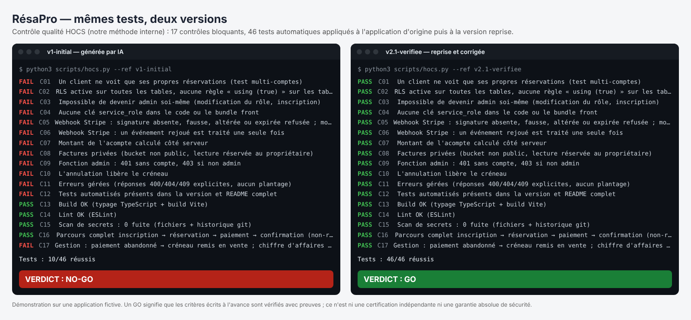
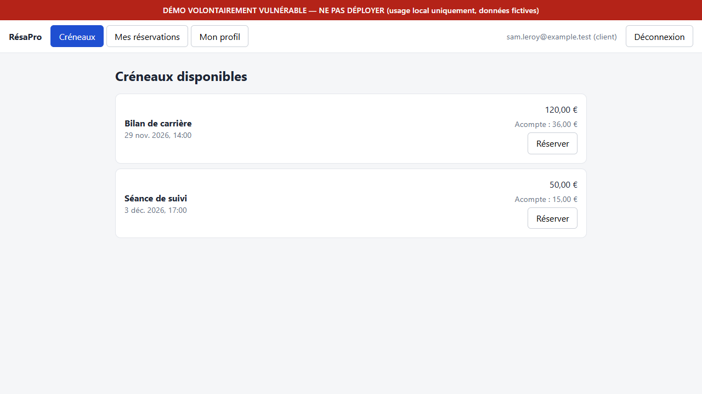
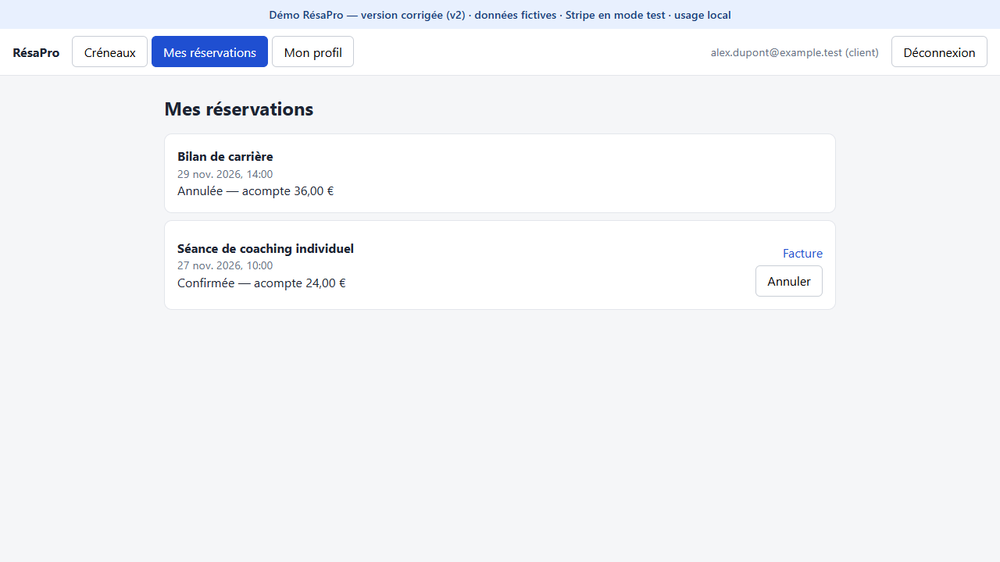
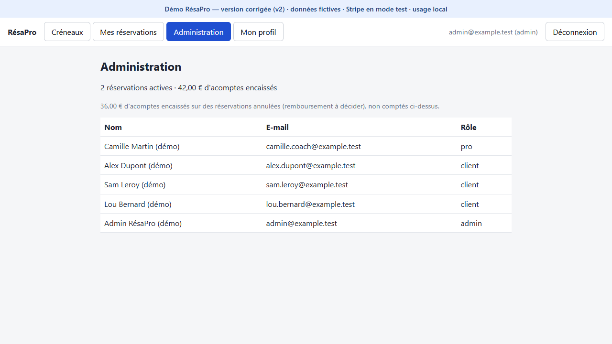
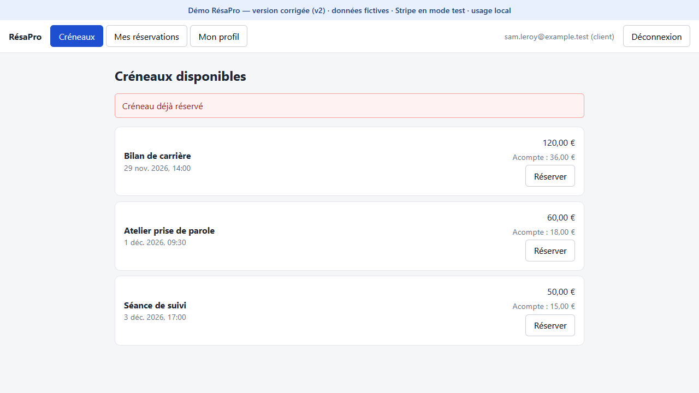

# Étude de cas — Reprendre une application créée avec l'IA avant de la confier à de vrais clients

> **Cas de démonstration.** RésaPro est une application fictive, construite pour cet exercice. Ses défauts ont été introduits volontairement : ce sont des défauts typiques des applications générées avec Lovable, Bolt, Replit ou Cursor. Aucune donnée réelle n'a été utilisée et aucun système en ligne n'a été touché. Le code corrigé et les tests sont dans ce dépôt ; les preuves « avant » sont figées dans `qa/`.

## 1. Le problème de départ

Une indépendante (coach, coiffeuse, consultante…) a fait générer par une IA son application de réservation. Ses clients choisissent un créneau, paient un acompte par carte, reçoivent une confirmation et une facture. Ils peuvent annuler. Un espace administrateur affiche le chiffre d'affaires.

Elle a cliqué partout : **tout fonctionne**. Elle se demande si elle peut ouvrir l'application à ses clients.

## 2. Pourquoi « ça marche » ne veut pas dire « c'est prêt »

Une IA construit d'abord ce qui se voit : les écrans et le parcours normal, celui où chacun fait ce qu'on attend de lui. Ce qui ne se voit pas en cliquant, c'est ce qui se passe quand quelqu'un sort du parcours prévu :

- un client curieux qui ouvre les outils de son navigateur ;
- quelqu'un qui modifie le montant avant de payer ;
- un faux message « paiement reçu » envoyé à l'application ;
- un client qui ferme la page de paiement sans payer.

Ces situations ne se testent pas à la souris. Il faut les provoquer volontairement, avec plusieurs comptes et des tests automatiques.

## 3. Ce que le diagnostic a trouvé

Neuf problèmes, dont six critiques. En langage simple :

| Ce qui n'allait pas | Ce qui pouvait arriver |
|---|---|
| La « clé maîtresse » de la base de données était envoyée à chaque visiteur du site | N'importe qui pouvait lire, modifier ou effacer toutes les données |
| Un utilisateur pouvait se déclarer lui-même administrateur | Prise de contrôle de l'espace admin par le premier curieux venu |
| La confirmation de paiement n'était pas authentifiée | Réserver sans payer ; recevoir deux fois la même confirmation |
| Le montant de l'acompte était décidé par le navigateur du client | Payer 1 € au lieu de 30 € |
| Les réservations de tous les clients étaient lisibles par tous | Fuite de données personnelles (qui a rendez-vous, quand) — risque RGPD |
| La page de statistiques admin était ouverte sans mot de passe | Liste des e-mails clients et chiffre d'affaires accessibles à tous |
| Les factures étaient stockées dans un dossier public | Factures des autres clients téléchargeables |
| Annuler ne remettait pas le créneau en vente ; les erreurs n'étaient jamais affichées | Créneaux perdus, clients bloqués sans explication |
| Aucun test automatique | Chaque modification pouvait tout casser sans que personne ne s'en aperçoive |

Ensuite, en faisant tourner l'application sur un vrai Supabase et dans un vrai navigateur, **deux défauts de gestion** sont apparus :

| Ce qui n'allait pas | Ce qui pouvait arriver |
|---|---|
| Un client qui abandonnait le paiement laissait le créneau bloqué | Créneau invendable tant que le client ne l'annulait pas lui-même |
| Le chiffre d'affaires de l'espace admin comptait aussi les réservations annulées | Un tableau de bord qui surestime les revenus |

Cette vérification a aussi mis au jour des problèmes techniques qu'aucun test sur base simulée ne pouvait voir (par exemple, toutes les réservations échouaient à cause d'un détail de configuration). C'est pour cela qu'une reprise sérieuse se termine toujours par un essai en conditions réelles.

Le détail de chaque problème, son emplacement exact et sa preuve sont dans le [diagnostic](diagnostic.md).

## 4. Ce qui a été corrigé, et comment

1. **Un diagnostic écrit et priorisé**, du plus grave (perte d'argent, fuite de données) au moins urgent.
2. **Les critères de réussite écrits avant de corriger** : 17 contrôles vérifiables ([`qa/criteres.md`](../qa/criteres.md)). Pas de « ça a l'air bon ».
3. **Chaque problème reproduit par un test automatique** qui échoue sur l'application d'origine. Les tests simulent deux clients, deux professionnels, un visiteur anonyme et un administrateur, ainsi que des tentatives simples : faux paiement, paiement rejoué, montant modifié, paiement abandonné.
4. **Une correction ciblée par problème**, expliquée dans l'historique du code (disponible sur demande), sans réécrire l'application : l'interface et le parcours existants sont conservés.
5. **Un contrôle final Go / No-Go** qui relance tout (tests, construction du site, qualité du code, recherche de mots de passe oubliés) et produit un rapport avec preuves.

## 5. Les preuves avant / après

_Avant : la version d'origine, lancée uniquement sur un poste local, signale qu'elle ne doit pas être mise en ligne._

_Après : le client voit sa réservation confirmée et sa facture privée ; l'annulation est bien prise en compte._

_Après : le chiffre d'affaires exclut les réservations annulées, dont les acomptes sont affichés à part._

_Après : si un autre client a pris le créneau entre-temps, l'application l'explique clairement._

| | Avant (v1) | Après (v2.1) |
|---|---|---|
| Verdict de notre contrôle qualité | **NO-GO** | **GO** |
| Contrôles réussis | 4 sur 17 | **17 sur 17** |
| Tests automatiques réussis | 10 sur 46 | **46 sur 46** |
| Un client voit les réservations des autres | Oui | Non |
| On peut devenir administrateur soi-même | Oui | Non |
| On peut payer moins que l'acompte | Oui (1 € au lieu de 30 €) | Non, le montant est fixé par le serveur |
| Un faux avis de paiement confirme la réservation | Oui | Non, il est rejeté |
| Un paiement reçu deux fois est compté deux fois | Oui | Non |
| Les factures sont privées | Non | Oui (liens valables 60 secondes) |
| Une annulation ou un paiement abandonné remet le créneau en vente | Non | Oui |
| Le chiffre d'affaires exclut les réservations annulées | Non | Oui |
| Les erreurs sont expliquées à l'utilisateur | Non | Oui |

Les mêmes tests sont appliqués aux deux versions : la différence vient uniquement des corrections. Les attaques du diagnostic ont aussi été rejouées sur un vrai Supabase local, et le parcours complet a été vérifié dans un navigateur ([rapport de vérification](../qa/verification-supabase-local.md)).

## 6. Ce que reçoit le propriétaire de l'application

- Un **rapport de diagnostic** compréhensible sans être développeur.
- Les **corrections**, une par problème, chacune expliquée.
- Une **batterie de tests** qu'il garde : toute future modification (par lui, par une IA ou par un autre prestataire) peut être revérifiée en une commande.
- Un **rapport Go / No-Go** daté, avec la preuve de chaque point.

## 7. Les limites de ces vérifications

- **Notre contrôle qualité (HOCS) n'est pas une certification indépendante.** C'est notre méthode, exécutée par nous. Le verdict GO veut dire : tous les critères écrits à l'avance sont vérifiés, avec preuves. Ce n'est **pas une garantie absolue de sécurité**.
- Ce n'est **ni un audit de sécurité complet, ni un test d'intrusion**. Les points vérifiés sont ceux du diagnostic ; d'autres sujets restent hors périmètre et sont listés à la fin du diagnostic (par exemple, le remboursement automatique en cas d'annulation).
- Les paiements ont été **simulés** : aucun paiement n'a été passé avec un vrai compte Stripe, même en mode test.
- Il s'agit d'une démonstration : même corrigée, RésaPro n'est pas destinée à être mise en ligne telle quelle.

---

**Votre application faite avec l'IA « marche », mais vous n'êtes pas sûr de pouvoir la confier à de vrais clients ?** Envoyez le lien de votre projet (GitHub, Lovable, Bolt…) et trois lignes de contexte : vous recevez un diagnostic écrit et priorisé, puis un devis à périmètre fixe. Tout se fait par écrit, et rien n'est testé sans votre autorisation écrite.

_Zakaria — Reprise Apps IA_
